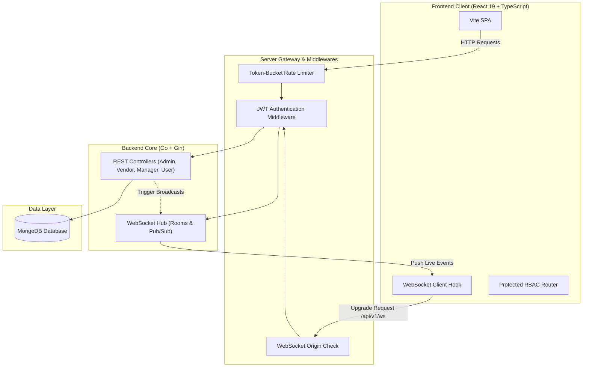
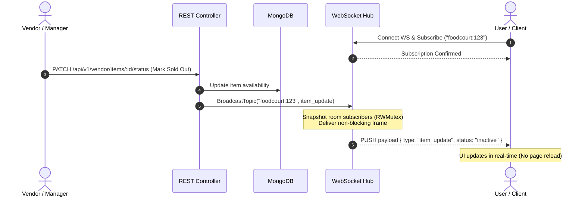

# Infybite

A high-concurrency, real-time food court and vendor management platform designed to replace whiteboard menus and eliminate stale availability statuses. Built with a Go micro-backend and a React/TypeScript single-page application, Infybite synchronizes live menu availability, vendor operations, and food court tracking across users, managers, vendors, and administrators.

---

## Tech Stack

### Frontend
* **Core:** React 19, TypeScript, Vite
* **Styling:** Tailwind CSS v4, Lucide React icons
* **State Management:** Zustand
* **Routing & Networking:** React Router v6 (with route-level code splitting via `React.lazy`), Axios

### Backend
* **Language & Framework:** Go 1.23+, Gin Web Framework
* **Database:** MongoDB (Official Go Mongo Driver: `go.mongodb.org/mongo-driver`)
* **Real-Time Engine:** Gorilla WebSocket (`github.com/gorilla/websocket`) with custom in-memory Hub pub/sub
* **Security & Auth:** Dual-token JWT (Access Token in memory, HTTP-only Cookie for Refresh Token with automated rotation), bcrypt password hashing, token-bucket IP rate limiting, strict WebSocket origin verification

---

## System Architecture

### High-Level Architecture



### Real-Time Event & Room Routing Flow



---

## Role-Based Access Control (RBAC)

The system enforces strict permission boundaries across four operational roles:

| Role | Scope & Privileges |
| :--- | :--- |
| **Admin** | Full system oversight. Manages global food courts, onboards vendors, monitors system health, and controls global platform state. |
| **Vendor** | Owns food court stalls and menu items. Assigns items to specific food courts, provisions operational managers, and updates prices/statuses. |
| **Manager** | Delegated by vendors to run live stall operations. Toggles real-time item availability (in stock / sold out / time slots) during service hours. |
| **User** | Public consumer interface. Browses active food courts, searches menus, and receives real-time WebSocket updates on item pricing and stock status. |

---

## Concurrency & Performance Benchmarks

The WebSocket Hub is architected for zero-allocation fan-out and non-blocking channel delivery to avoid deadlock and lock contention under burst traffic.

### 1. In-Memory Hub Fan-Out Benchmark (`go test -bench`)
*Tested on an AMD Ryzen 5 7535HS (6 cores / 12 threads), Go 1.23 (linux/amd64):*

| Benchmark Test | Operations | Latency (ns/op) | Memory Alloc | Allocs/Op |
| :--- | :--- | :--- | :--- | :--- |
| `BenchmarkHub_Broadcast_100Clients` | 76,015 | **7.9 µs/op** | 0 B/op | **0 allocs/op** |
| `BenchmarkHub_Broadcast_500Clients` | 10,000 | **120.9 µs/op** | 0 B/op | **0 allocs/op** |
| `BenchmarkHub_Broadcast_1000Clients` | 10,000 | **252.0 µs/op** | 0 B/op | **0 allocs/op** |
| `BenchmarkHub_Broadcast_5000Clients` | 10,000 | **1.72 ms/op** | 0 B/op | **0 allocs/op** |
| `BenchmarkHub_TopicRouting_1000Clients` | 10,000 | **220.2 µs/op** | 33.5 KB/op | 13 allocs/op |

> **Key Architectural Detail:** Global broadcasts achieve **0 B/op and 0 allocs/op** because the hub broadcasts the pointer/slice directly to pre-allocated buffered client channels without per-subscriber heap allocations.

### 2. High-Concurrency Stress Test (`scripts/loadtest`)
*Results from running 1,000 concurrent subscribers receiving 3,000 burst broadcasts:*

* **Concurrent Subscribers:** 1,000 active clients
* **Total Messages Delivered:** 1,041,411 deliveries
* **Total Test Time:** 489 ms
* **Fan-Out Throughput:** **2,127,668 deliveries / sec**
* **Latency Distribution:**
  * **Min:** 908 ns
  * **p50 (Median):** 216 µs
  * **p95:** 294 µs
  * **p99:** 352 µs
  * **Max:** 844 µs
* **Buffer Overflow Drops:** 0 (100% delivery reliability)

---

## Local Setup & Installation

### Prerequisites
* **Go:** 1.22+
* **Node.js:** 18+ (Node 20+ recommended)
* **MongoDB:** Local instance or MongoDB Atlas cluster connection string

---

### Step 1: Clone Repository

```bash
git clone https://github.com/MohdMusaiyab/infybyte.git
cd infybyte
```

---

### Step 2: Configure Environment Variables

#### Backend (`server/.env`)
Copy the sample configuration:
```bash
cp server/.env.sample server/.env
```
Ensure the values in `server/.env` match your local environment:
```env
GIN_MODE=debug
PORT=1234
MONGO_URI=mongodb://localhost:27017/infybite
ACCESS_SECRET=your-secure-access-jwt-secret-min-32-chars
REFRESH_SECRET=your-secure-refresh-jwt-secret-min-32-chars
FRONTEND_URL=http://localhost:5173
```

#### Frontend (`client/.env`)
Copy the sample configuration:
```bash
cp client/.env.sample client/.env
```
Ensure the API URL points to your backend:
```env
VITE_API_URL=http://localhost:1234/api/v1
```

---

### Step 3: Run Backend

```bash
cd server
go mod download
go run cmd/main.go
```
The server will boot on `http://localhost:1234`.

---

### Step 4: Run Frontend

In a separate terminal:
```bash
cd client
npm install
npm run dev
```
The client application will start on `http://localhost:5173`.

---

## Running Tests & Benchmarks

### 1. Run Backend Unit & Integration Tests
Runs all unit tests across handlers, controllers, middlewares, and websocket packages:
```bash
cd server
go test -v ./...
```

### 2. Run Go WebSocket Benchmarks
Measures execution speed and memory allocations per operation:
```bash
cd server
go test -bench=. -benchmem -benchtime=500ms ./internal/websocket
```

### 3. Run Automated WebSocket Load & Stress Test
Simulates burst traffic across 1,000 subscribers and calculates p50, p95, and p99 latency percentiles:
```bash
cd server
go run ./scripts/loadtest/main.go -clients 1000 -messages 5000
```

### 4. Run HTTP REST API Benchmark (Server Must Be Running)
Measures requests per second (RPS) and verifies token-bucket rate limiter responsiveness:
```bash
cd server
go run ./scripts/loadtest/main.go -type http -url http://localhost:1234/api/v1/health -requests 1000 -workers 50
```

### 5. Run Frontend Lint & Production Build
Verifies TypeScript compilation and tree-shaking:
```bash
cd client
npm run lint
npm run build
```

---

## Directory Structure

```text
infybyte/
├── client/                     # Frontend Application
│   ├── public/                 # Favicon, logo, and 1200x630 OG preview card
│   ├── src/
│   │   ├── components/         # Reusable UI components & layouts (RBAC protected)
│   │   ├── context/            # WebSocket context & real-time connection provider
│   │   ├── hooks/              # Custom hooks (useAuth, useWebsocket, useModal)
│   │   ├── pages/              # Code-split page components (Admin, Vendor, Manager, User)
│   │   ├── routes/             # Client-side router configuration & lazy-loaded routes
│   │   ├── store/              # Zustand state stores
│   │   └── utils/              # Axios instance with automated token-refresh interceptor
│   └── index.html              # HTML shell with full SEO, OG, and Twitter Card tags
│
└── server/                     # Backend Application
    ├── cmd/                    # Application entry point (main.go)
    ├── config/                 # MongoDB database driver initialization
    ├── internal/
    │   ├── controllers/        # HTTP handlers for business logic (Auth, FoodCourt, Items)
    │   ├── handlers/           # WebSocket upgrade, origin validation, and connection loop
    │   ├── middlewares/        # JWT auth, RBAC enforcement, and Token-Bucket IP rate limiter
    │   ├── models/             # MongoDB data models & BSON schema definitions
    │   ├── utils/              # JWT signing, response helpers, and broadcast adapters
    │   └── websocket/          # Hub event loop, client abstraction, and concurrency safety
    ├── routes/                 # Route group definitions (/api/v1)
    └── scripts/loadtest/       # Standalone Go load testing & latency distribution CLI
```
